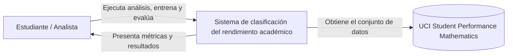
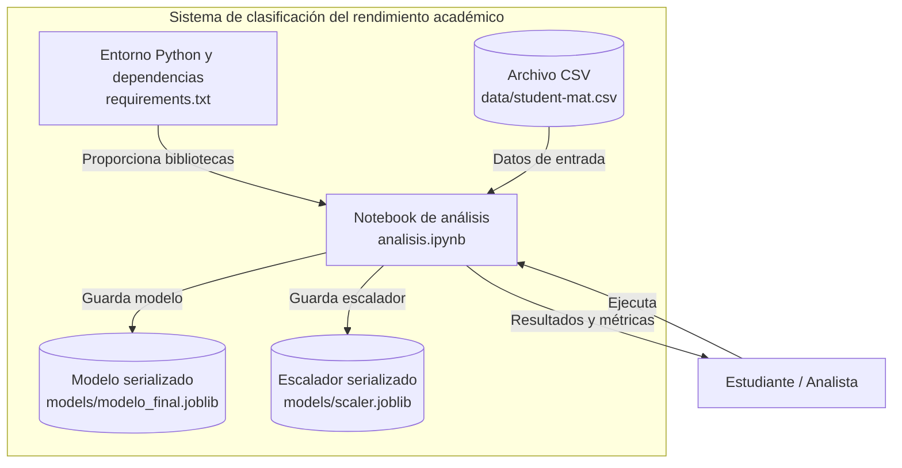

# Arquitectura del sistema — Mini-proyecto de Machine Learning

## 1. Información general

| Campo | Descripción |
|---|---|
| Proyecto | Mini-proyecto de Machine Learning para predecir el rendimiento académico en matemáticas |
| Tipo de sistema | Prototipo de análisis y clasificación predictiva |
| Arquitectura | Flujo local de procesamiento de datos y entrenamiento de modelos |
| Lenguaje principal | Python |
| Entorno de ejecución | Jupyter Notebook |
| Modelo seleccionado | Regresión logística |
| Versión documental | 1.0 |
| Estado | Prototipo académico |

## 2. Propósito del sistema

El propósito del proyecto es desarrollar un modelo básico de Machine Learning capaz de clasificar el rendimiento académico de estudiantes en matemáticas, mediante la predicción de dos posibles resultados: aprueba o no aprueba.

Para desarrollar el modelo se utiliza el conjunto de datos Student Performance Mathematics, obtenido del repositorio UCI Machine Learning Repository.

El sistema permite cargar y analizar los datos, realizar transformaciones y preprocesamiento, entrenar modelos de clasificación, evaluar su desempeño mediante métricas cuantitativas y almacenar los componentes necesarios para reutilizar el modelo seleccionado.

## 3. Alcance de la arquitectura

### 3.1 Funcionalidades incluidas

- Carga del conjunto de datos `student-mat.csv`.
- Exploración y análisis de variables.
- Construcción de la variable objetivo `aprueba`.
- Transformación de variables categóricas mediante codificación One-Hot.
- Normalización de características mediante StandardScaler.
- División de los datos en conjuntos de entrenamiento y prueba.
- Entrenamiento de un modelo de referencia DummyClassifier.
- Entrenamiento y evaluación de modelos de regresión logística.
- Evaluación mediante Accuracy, Precision, Recall, F1-score y matriz de confusión.
- Persistencia de los componentes del modelo utilizando Joblib.

### 3.2 Funcionalidades fuera del alcance

- Despliegue del modelo en un servidor.
- API REST para consumir predicciones.
- Interfaz gráfica para usuarios finales.
- Conexión automática con sistemas académicos institucionales.
- Predicción en tiempo real desde una aplicación externa.
- Reentrenamiento automático del modelo.

## 4. Arquitectura C4 — Nivel 1: Contexto del sistema

El diagrama de contexto representa la relación entre el usuario que desarrolla y analiza el modelo, el sistema de Machine Learning y la fuente de datos utilizada.

### Descripción de los elementos

- **Estudiante / Analista:** responsable de ejecutar el notebook, revisar los resultados y analizar el desempeño del modelo.
- **Sistema de clasificación:** conjunto de procesos implementados en Python para preparar los datos, entrenar y evaluar el modelo.
- **UCI Student Performance Mathematics:** fuente original del conjunto de datos utilizado para el desarrollo del proyecto. El archivo se encuentra almacenado localmente después de su obtención.

## 5. Arquitectura C4 — Nivel 2: Contenedores

La solución se ejecuta localmente y utiliza archivos como mecanismos de entrada y persistencia.

### Descripción de los contenedores

| Elemento | Responsabilidad |
|---|---|
| Entorno Python | Proporciona el entorno de ejecución y las bibliotecas necesarias para el proyecto. |
| Notebook `analisis.ipynb` | Contiene el flujo de análisis exploratorio, preprocesamiento, entrenamiento y evaluación. |
| `student-mat.csv` | Archivo que contiene los registros académicos utilizados como entrada. |
| `modelo_final.joblib` | Archivo serializado que contiene el modelo de clasificación seleccionado. |
| `scaler.joblib` | Archivo serializado que contiene el escalador utilizado en el preprocesamiento. |
| `requirements.txt` | Define las versiones de las dependencias utilizadas. |

## 6. Flujo de procesamiento de datos

El procesamiento sigue las siguientes etapas:

1. **Carga de datos:** se lee el archivo `student-mat.csv` mediante Pandas.
2. **Exploración:** se analizan las características, tipos de variables y distribución de los datos.
3. **Construcción del objetivo:** se genera la variable binaria `aprueba`, asignando 1 cuando la calificación final G3 es mayor o igual a 10 y 0 cuando es inferior a 10.
4. **Selección de características:** se excluyen G1 y G2 como variables predictoras para evitar depender de calificaciones parciales al realizar la clasificación.
5. **Codificación:** las variables categóricas se transforman mediante One-Hot Encoding utilizando `pandas.get_dummies()`.
6. **Escalado:** se utiliza StandardScaler para estandarizar las características numéricas.
7. **División de datos:** se utiliza una proporción de 80 % para entrenamiento y 20 % para prueba.
8. **Entrenamiento:** se utiliza DummyClassifier como referencia y regresión logística como modelo de clasificación.
9. **Evaluación:** se calculan métricas de clasificación y se genera la matriz de confusión.
10. **Persistencia:** se guardan el modelo y el escalador mediante Joblib.

## 7. Tecnologías utilizadas

| Tecnología | Uso |
|---|---|
| Python | Lenguaje de programación principal. |
| Pandas | Manipulación y análisis de datos. |
| NumPy | Operaciones numéricas. |
| Scikit-learn | Preprocesamiento, entrenamiento y evaluación de modelos. |
| Matplotlib | Visualización de datos y resultados. |
| SciPy | Funciones científicas y numéricas utilizadas por el entorno. |
| Joblib | Serialización y almacenamiento de componentes del modelo. |
| Jupyter Notebook | Entorno interactivo de desarrollo y experimentación. |

## 8. Persistencia y reutilización

Los artefactos generados se almacenan en la carpeta `models/`.

- `modelo_final.joblib`: contiene el estimador de clasificación seleccionado.
- `scaler.joblib`: contiene el objeto StandardScaler utilizado durante el procesamiento.

Para reutilizar correctamente el modelo se debe conservar el mismo orden y estructura de características aplicado durante su entrenamiento, incluyendo la codificación de variables categóricas.

Los archivos serializados no constituyen por sí solos un servicio de predicción desplegado.

## 9. Consideraciones de calidad y seguridad

- El conjunto de datos debe conservarse sin modificaciones no documentadas.
- Se debe evitar la exposición innecesaria de información estudiantil.
- Los artefactos serializados deben obtenerse de fuentes confiables antes de cargarlos.
- La evaluación debe realizarse sobre datos que no hayan sido utilizados para entrenar el modelo.
- Las transformaciones aprendidas, como el escalado, deben ajustarse exclusivamente con los datos de entrenamiento y aplicarse posteriormente al conjunto de prueba.
- Las predicciones no deben utilizarse como único criterio para tomar decisiones académicas sobre estudiantes.

## 10. Limitaciones

El sistema es un prototipo académico desarrollado con un conjunto de datos específico. Sus resultados no garantizan un desempeño equivalente en instituciones educativas diferentes ni en poblaciones de otros países.

La calidad predictiva está condicionada por el tamaño, la distribución y las características del conjunto de datos. Además, la regresión logística utiliza una frontera de decisión lineal, por lo que puede no representar adecuadamente relaciones complejas entre variables.

El modelo debe considerarse una herramienta experimental de apoyo al análisis, no un mecanismo autónomo para tomar decisiones académicas.

## 11. Referencias

- UCI Machine Learning Repository. Student Performance Dataset. https://archive.ics.uci.edu/dataset/320/student+performance
- Scikit-learn. Machine Learning in Python. https://scikit-learn.org/stable/
- Pandas Documentation. https://pandas.pydata.org/docs/
- Joblib Documentation. https://joblib.readthedocs.io/en/stable/
- Project Jupyter. Documentation. https://docs.jupyter.org/
